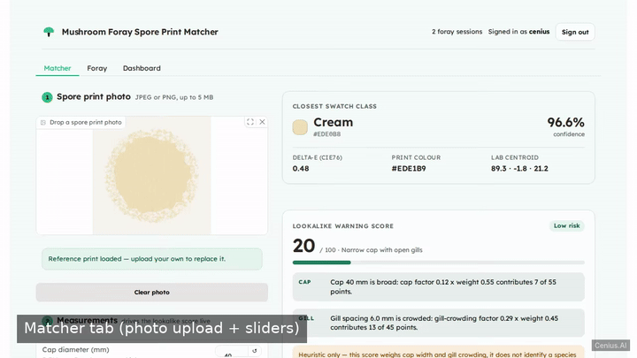
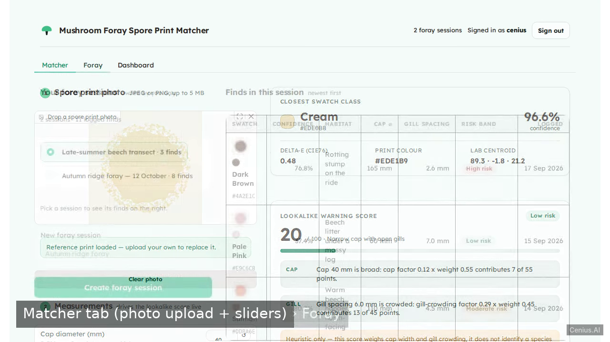
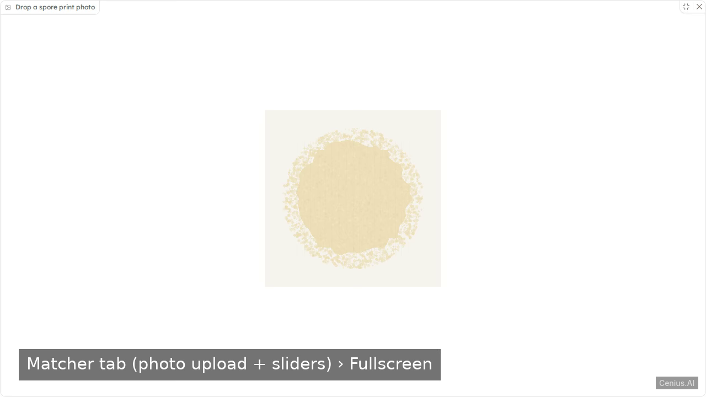

# Mushroom Foray Spore Print Matcher — complete Full-stack app monitoring dashboard example app

This repository contains the complete source for **Mushroom Foray Spore Print Matcher**, an open-source monitoring dashboard built with Full-stack app. Build a local-first Gradio web app for mushroom foragers: sign in with a local account, upload a spore print photo to get the closest seeded colour-swatch class, move cap-diameter and gill-spacing sliders to compute a…. Everything Mushroom Foray Spore Print Matcher needs to run is here — code, seed data, install scripts. Apache-2.0-licensed — use Mushroom Foray Spore Print Matcher commercially, self-host it, or [remix Mushroom Foray Spore Print Matcher on cenius.ai](https://cenius.ai/marketplace/p/mushroom-foray-spore-print-matcher?ref=gh&utm_campaign=mushroom-foray-spore-print-matcher-webapp) to make it yours.


[](LICENSE)  [](https://cenius.ai)

[](https://cenius.ai/marketplace/p/mushroom-foray-spore-print-matcher?ref=gh&utm_campaign=mushroom-foray-spore-print-matcher-webapp)

> **▶ [Open & edit in cenius.ai](https://cenius.ai/marketplace/p/mushroom-foray-spore-print-matcher?ref=gh&utm_campaign=mushroom-foray-spore-print-matcher-webapp)** — one click to an editable workspace: describe changes in plain English, get an instant preview, one-click deploy and host. Modifications made on the platform come with full rebrand & relicense rights.

_Local clone? See [Quick start](#quick-start) below. cenius.ai is the zero-setup path._

## Demo



📽 **[Demo video on cenius.ai](https://cenius.ai/marketplace/p/mushroom-foray-spore-print-matcher?ref=gh&utm_campaign=mushroom-foray-spore-print-matcher-webapp)** — the complete run-through · [MP4](.github/media/demo.mp4)

## Screenshots

  

## Features

- Local account access
- Spore print photo colour matcher
- Cap and gill lookalike warning score
- Foray session find log
- Interactive foray dashboard
- Seed data and local persistence
- Clean minimal UI shell

## Architecture

The repository contains 56 files of Full-stack app source, organised under `static/`, `templates/`, `tests/`, `tools/`, `uploads/`. Starting up is just `./install.sh`: it installs what is needed and pre-fills the database so you have data to work with straight away. Full setup details: [`INSTALL.md`](INSTALL.md).

## Quick start

```bash
./install.sh   # installs dependencies + seeds demo data
```

See [`INSTALL.md`](INSTALL.md) for full setup and usage instructions.

## Usage guide

Start it with `python3 app.py` and open <http://localhost:7860>. Everything below describes the
running product, top to bottom.

### 1. Sign in

The front door is a centred sign-in card served at `/` (and at `/login`) for anyone who is not
signed in; signed-in visitors land straight on the Matcher tab.

- Sign in with the demo account: **cenius@cenius.ai / cenius** (username `cenius` works too), or the
  second seeded account **demo / demo1234**. Both are printed on the card, each owns the same seeded
  foray history, and the **Fill demo credentials** button types the first pair for you.
- **Show / Hide** toggles the password field between masked and readable text.
- **Create account** switches the same card into registration mode: usernames are 3–30 characters
  (letters, numbers, dot, dash, underscore) and passwords need at least 8 characters.
- A failed sign-in always says **“Username or password is incorrect”** — never whether the username
  exists.
- The session is a signed HttpOnly cookie, so a page reload keeps you signed in. **Sign out** lives
  in the top-right of the app header.

### 2. Matcher tab

_Full guide: [`USAGE.md`](USAGE.md)_

## FAQ

### How do I get Mushroom Foray Spore Print Matcher running locally?

Grab the repo and run `./install.sh` — it handles packages and seed data in one go. After that, [`INSTALL.md`](INSTALL.md) walks you through starting the server. No external accounts required.

### How is Mushroom Foray Spore Print Matcher built technically?

The app is built with Full-stack app. What you see in this repo is the full production source, demo data included. Highlights include spore print photo colour matcher.

### Is Mushroom Foray Spore Print Matcher free for commercial use?

It is. Apache-2.0 licensing means you can build a product on it, sell it, or use it inside a company with no fees. Details: [LICENSE](LICENSE).

### How do I make Mushroom Foray Spore Print Matcher my own brand?

Rebranding is straightforward under the MIT license — change what you want in the source. Or [open it on cenius.ai](https://cenius.ai/marketplace/p/mushroom-foray-spore-print-matcher?ref=gh&utm_campaign=mushroom-foray-spore-print-matcher-webapp): the platform handles the changes and grants full rebrand rights on the result.

### Is Mushroom Foray Spore Print Matcher editable without a developer?

Open it on [cenius.ai](https://cenius.ai/marketplace/p/mushroom-foray-spore-print-matcher?ref=gh&utm_campaign=mushroom-foray-spore-print-matcher-webapp) and describe the changes you want in plain English — the platform modifies the app and gives you a new, downloadable build.

## License & rebranding

Released under the [Apache License 2.0](LICENSE) (© 2026 Cenius AI) — free for personal and commercial use. The Cenius name/logo are trademarks (see NOTICE).

**Need a customized version?** [Remix this app on cenius.ai](https://cenius.ai/marketplace/p/mushroom-foray-spore-print-matcher?ref=gh&utm_campaign=mushroom-foray-spore-print-matcher-webapp) — modifications made on the platform come with **full rebrand & relicense rights** over your derivative.

## Built with cenius.ai

This entire application — code, design, seeded demo data — was generated on **[cenius.ai](https://cenius.ai)** from a plain-English description.

- 🚀 [Build your own app on cenius.ai](https://cenius.ai)
- 🎛️ [Remix Mushroom Foray Spore Print Matcher on the marketplace](https://cenius.ai/marketplace/p/mushroom-foray-spore-print-matcher?ref=gh&utm_campaign=mushroom-foray-spore-print-matcher-webapp) — open it in a workspace, prompt for changes, and ship your own version.

More open-source apps: [the Cenius-ai catalog](https://github.com/Cenius-ai) · [showcase index](https://github.com/Cenius-ai/showcase)
